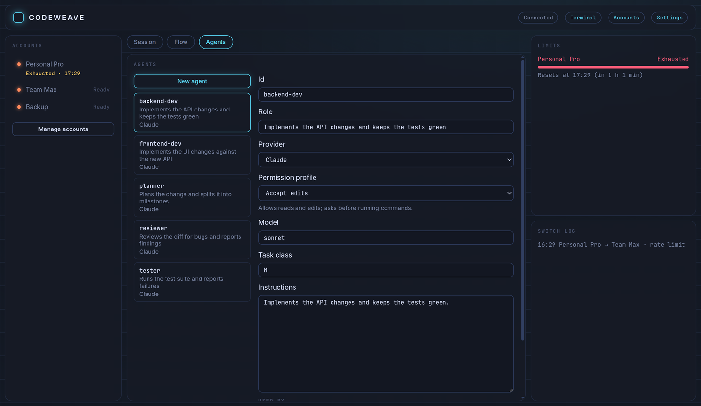

# Codeweave

Electron + React + TypeScript desktop app. The orchestration backend runs in an
Electron `utilityProcess` and talks to the renderer over a `MessagePort` with a
zod-validated, versioned protocol (`src/shared/protocol.ts`).

## Download and install

Installers for Linux, Windows and macOS are attached to the
[GitHub Releases](https://github.com/shrektu/codeweave/releases) page. Builds
are unsigned until signing credentials are configured, so the first launch
needs an extra step on Windows and macOS. Cutting a release and the signing
setup are described in [docs/releasing.md](docs/releasing.md).

### Linux

Pick the package for your distribution and architecture. File names below are
for x64; the arm64 files are `Codeweave-<version>-arm64.AppImage`,
`codeweave_<version>_arm64.deb` and `codeweave-<version>.aarch64.rpm`.

- AppImage (`Codeweave-<version>.AppImage`): make it executable and run it.

  ```sh
  chmod +x Codeweave-<version>.AppImage
  ./Codeweave-<version>.AppImage
  ```

  The AppImage needs FUSE 2: install `libfuse2t64` on Ubuntu 24.04 and newer,
  `libfuse2` before that. Without FUSE run
  `./Codeweave-<version>.AppImage --appimage-extract-and-run`, or set
  `APPIMAGE_EXTRACT_AND_RUN=1`.
- Debian and Ubuntu (`codeweave_<version>_amd64.deb`):
  `sudo apt install ./codeweave_<version>_amd64.deb`
- Fedora and RHEL (`codeweave-<version>.x86_64.rpm`):
  `sudo dnf install ./codeweave-<version>.x86_64.rpm`

The deb and rpm packages do not need FUSE.

### Windows

Run `Codeweave-Setup-<version>.exe`. It installs per user and lets you choose
the directory. While the installer is unsigned, SmartScreen shows "Windows
protected your PC": choose "More info", then "Run anyway".

### macOS

Download `Codeweave-<version>-x64.dmg` (Intel) or
`Codeweave-<version>-arm64.dmg` (Apple silicon), open it and drag Codeweave to
Applications. The matching `.zip` files hold the same app. The app is not
notarized yet, so the first launch needs an extra step, described under
"Unsigned builds" in [docs/releasing.md](docs/releasing.md).

## Build from source

Requirements:

- Node.js 24 or newer
- pnpm 12 (`corepack enable` picks the version from `package.json`)

```sh
pnpm install
```

## Develop

```sh
pnpm dev
```

## Agents

Flow nodes run agents. An agent is defined in a Markdown file directly in the
`agents/` folder of your repository. Each definition is a YAML front-matter
block followed by the instructions the agent gets as its prompt; one file may
hold several agents, each starting with its own `---` block.

```md
---
id: docs-writer
role: Writes the docs
provider: claude
model: sonnet
permissionProfile: accept-edits
taskClass: standard
---

Write the docs for the change.
```

- `id`, `role`, `provider` (`claude`, `codex`, `gemini` or `opencode`) and
  `permissionProfile` (`bypass`, `unattended`, `accept-edits`, `ask` or `plan`)
  are required.
- `model` and `taskClass` are optional. The editor suggests models from the
  OpenCode catalog for OpenCode agents only; for other providers `model` is
  free text. Leave it empty or set `auto` to let task-class routing choose.
  Every agent CLI receives the model with each turn, in the format of its
  provider:
  - Claude: an alias (`sonnet`, `opus`, `haiku`) or a model id Claude Code lists.
  - Codex: a Codex model id.
  - Gemini: a model name as `agy models` shows it, for example
    `Gemini 4 Hydrogen (Medium)`.
  - OpenCode: `<provider>/<model>`, for example `groq/openai/gpt-oss-20b`.
- `taskClass` is `light`, `standard` or `heavy`. On OpenCode API-key accounts
  Codeweave picks a model per turn from the class; subscription accounts keep
  the CLI default. The composer lets you choose a class and a model for the next
  prompt, and every turn shows a badge with the model that handled it. Details
  in [docs/model-routing.md](docs/model-routing.md).
- The text after the front matter is the agent's instructions.

The **Agents** tab creates, edits, renames and deletes these files after you
pick the repository folder. Renaming or deleting an agent is refused while a
flow uses it; the tab lists the flows that do. Saved changes apply to the next
flow run without restarting the app.



## Terminal

A terminal docks at the bottom of the centre column. Toggle it with the
`Terminal` button in the header or with ``Ctrl+` `` (backquote); drag the splitter
above it, or focus the splitter and use the arrow keys, to resize it.

- The shell starts in the session folder. Without a session, `Open in folder…`
  asks for one.
- The shell is detected automatically: `$SHELL` on macOS and Linux, PowerShell
  on Windows. Set a different one under Settings → Terminal shell; leave it
  empty to detect again.
- Hiding the dock keeps the shell running; showing it again replays the recent
  output. `Close` ends the shell. A shell that exits shows its exit code and a
  `Restart` button.
- The renderer is WebGL when the GPU is accelerated and falls back to DOM
  rendering otherwise or when the WebGL context is lost.

## Updates

Codeweave checks the GitHub Releases of `shrektu/codeweave` at start and every
6 hours. It only notifies: a banner offers a `View release` link, and nothing
is downloaded or installed. In Settings you can switch the check off and pick
the Stable or Beta (pre-releases) channel.

## Checks

```sh
pnpm lint
pnpm typecheck
pnpm test
```

## Build, end-to-end tests and packaging

The end-to-end tests drive the built app in `out/`, so build first:

```sh
pnpm build
pnpm e2e
pnpm run pack
```

`pnpm pack` is a built-in pnpm command, so the unpacked build is started with
`pnpm run pack` (output in `release/`).

Release installers are built per operating system on a native runner with
`node scripts/release/build.ts <linux|windows|mac>` after `pnpm build`. The
script runs electron-builder with the signing options that the available
environment variables allow and then checks that every packaged app holds only
binaries of its own architecture. The app icons in `build/` are generated from
`build/icon.svg` with `node scripts/release/icon.ts` (needs a display, or run it
under `xvfb-run`). The release workflow
(`.github/workflows/release.yml`) runs it for every `v*` tag; see
[docs/releasing.md](docs/releasing.md).

In CI, `tests/e2e/terminal.spec.ts` also drives the packed app on all three
systems: `CODEWEAVE_E2E_EXECUTABLE` points at the unpacked executable, for
example `release/linux-unpacked/codeweave`. Outside CI the spec skips this
mode, because the packed app ignores `CODEWEAVE_USER_DATA_DIR` and would use
your real profile.
